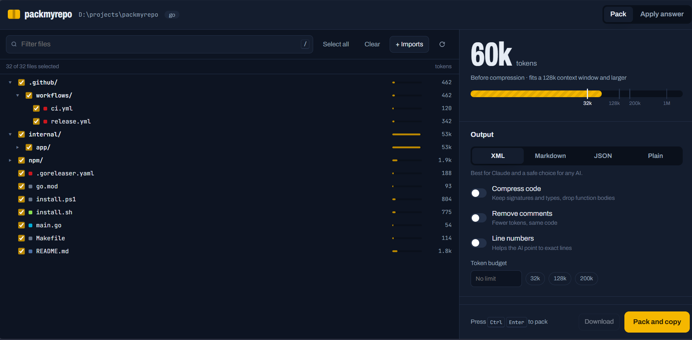

<h1 align="center">packmyrepo</h1>

<p align="center">
  <b>Ship your whole codebase to any AI in one file. Then apply its answer back to your code.</b>
</p>

<p align="center">
  <a href="https://www.npmjs.com/package/packmyrepo"></a>
  <a href="https://github.com/sahbadal/packmyrepo/actions/workflows/ci.yml"></a>
  <a href="LICENSE"></a>
</p>

---

ChatGPT, Claude and Gemini give much better answers when they can see your **whole project**, not one pasted file.
packmyrepo turns a project into a single, clean, AI-ready file in milliseconds, keeps your secrets out of it,
and when the AI answers with changed files, shows you exactly what changes and writes them back with a backup.

```bash
npx packmyrepo --copy
```

That's it. Your project is now on the clipboard. Paste it into any AI chat.



## How it works

1. **Pack**: `packmyrepo` reads your project, skips junk (`node_modules`, builds, lock files, images), hides secrets, and writes one file.
2. **Ask**: paste it into ChatGPT, Claude or Gemini with your question.
3. **Apply**: copy the AI's reply and run `packmyrepo apply`. You see every changed line first, then the files are written back. `packmyrepo undo` restores everything.

Prefer clicking? `packmyrepo ui` opens a local page where you tick files, watch the token count, pack with one button, and paste the AI's answer to apply it.

## Install

Pick whichever is easiest for you. All of them install the same small native program.

| You have      | Run                                                                                               |
| ------------- | ------------------------------------------------------------------------------------------------- |
| Node.js       | `npx packmyrepo` (no install) or `npm install -g packmyrepo`                                      |
| Windows       | `irm https://raw.githubusercontent.com/sahbadal/packmyrepo/main/install.ps1 \| iex` in PowerShell |
| macOS / Linux | `curl -fsSL https://raw.githubusercontent.com/sahbadal/packmyrepo/main/install.sh \| sh`          |
| Go            | `go install github.com/sahbadal/packmyrepo@latest`                                                |

Or download a zip from the [Releases page](https://github.com/sahbadal/packmyrepo/releases). The installers check every download against its SHA-256 checksum before installing.

> [!TIP]
> `npx` can keep using an old cached copy. Run `npx packmyrepo@latest` to be sure you get the newest version.

## Quick start

```bash
packmyrepo                         # pack this folder -> packmyrepo-output.xml
packmyrepo --copy                  # ...and copy it to the clipboard
packmyrepo src/api                 # only one folder (paths stay correct)
packmyrepo ui                      # choose files in your browser
packmyrepo apply                   # write the AI's answer back (reads the clipboard)
packmyrepo undo                    # undo the last apply
```

## Everyday recipes

| I want to…                                              | Command                                                            |
| ------------------------------------------------------- | ------------------------------------------------------------------ |
| Make it smaller (keep signatures, drop function bodies) | `packmyrepo -c`                                                    |
| Fit a token limit automatically                         | `packmyrepo --budget 100k`                                         |
| Send one feature and everything it imports              | `packmyrepo --entry src/app.ts`                                    |
| Send only what I changed                                | `packmyrepo --diff`                                                |
| Get my branch reviewed                                  | `packmyrepo --since main --with-diff -p review`                    |
| Get changes I can apply in one command                  | `packmyrepo -p bugs` or `packmyrepo --ask "add dark mode" --edits` |
| Apply an answer where I copied only the code            | `packmyrepo apply --to src/app.ts`                                 |
| Pack a GitHub repo without cloning it myself            | `packmyrepo facebook/react -c`                                     |
| Split a huge repo into several prompts                  | `packmyrepo --split 100k`                                          |
| Get Markdown instead of XML                             | `packmyrepo -f md`                                                 |

Too big for one prompt? packmyrepo shows the biggest folders and ready-to-run commands (`-c`, `--budget`, `--split`, or one folder). In `packmyrepo ui`, you can skip a big folder with one click.

Run `packmyrepo help` for every option and `packmyrepo prompts` for the ready-made prompts
(review, bugs, explain, docs, tests, refactor, feature, security).

## Applying the AI's answer safely

The AI can be wrong. packmyrepo makes its changes easy to check and easy to take back, but you stay in charge.

**1. Commit first.** Then `git diff` will show only what the AI changed.

**2. Ask for an answer you can apply.** Use `--edits` (or a prompt like `-p bugs`). The AI is told to put every changed file, complete, in **one code box**:

```bash
packmyrepo src/lib/utils.ts --edits --copy --ask "Add a formatINR function"
```

**3. Copy the AI's answer.** The copy button of that code box is enough. Copying the whole reply also works.

**4. Apply.**

```bash
packmyrepo apply
```

You see every changed line first (green added, red removed) and a short summary, and nothing is written until you type `y`:

```
─── src/lib/utils.ts
@@ -15,6 +15,11 @@
   return `tel:${siteConfig.contact.phoneRaw}`;
 }

+/** Formats a number as Indian rupees. */
+export function formatINR(amount: number) {
+  return `₹${amount.toLocaleString("en-IN")}`;
+}
+

  modify src/lib/utils.ts +5 -0

Apply 1 change(s)? [y/N]
```

**5. Check it.** Run your app or tests and read `git diff`. Happy? Commit. Not happy?

```bash
packmyrepo undo
```

**What packmyrepo protects you from:**

- **Placeholders.** Files where the AI wrote `// ... existing code ...` instead of the real code are skipped.
- **Wrong paste.** If the copied text would replace almost a whole file (for example a command that ended up on the clipboard), it is skipped.
- **Leaving the project.** Paths like `../other` or absolute paths are refused, and `.git` is never touched.
- **Losing work.** Every changed or deleted file is backed up in `.packmyrepo/backups` (added to `.gitignore` for you).
- **Noise in your diffs.** Your file's line endings and final newline are kept as they were.

Useful options: `--dry-run` shows the changes without writing anything, `--to <file>` applies code that was copied without its `<file path="...">` lines, `--force` writes files that were skipped on purpose, and `--yes` skips the question.

## Why packmyrepo

- **Apply with a preview, and undo.** The AI's answer goes straight back into your files after you have seen every changed line.
- **Smart token budget.** Give a limit and packmyrepo fits it. Tests, styles and tooling configs go first; framework entry points like Next.js pages, layouts and API routes are kept the longest.
- **Follows imports.** Start from one file and get exactly the code it depends on, for JS/TS, Python, Go, Rust, Java/Kotlin, Dart, C/C++ and PHP.
- **Git aware.** Pack only changed files, everything since a branch, and the diff itself.
- **Honest with the AI.** When only part of a project is packed (one folder, changed files, one feature), the pack says so, so the AI does not assume the rest does not exist.
- **Secrets hidden, not dropped.** API keys, tokens and passwords become `[REDACTED:type]`. `.env` files keep their variable names, so the AI still knows which settings exist.
- **Zero config, less noise.** Detects Node, Python, Go, Rust, Flutter, Java, PHP, Ruby, .NET and Terraform projects and skips their build folders, plus files AI never needs (`.gitignore`, `LICENSE`, `*.svg`, upload folders, earlier packmyrepo outputs).
- **Fast.** A native binary that reads files on every CPU core and remembers token counts between runs, so the second pack of a big repo takes a few seconds.

## Which format should I use?

| Format        | Flag      | Best for                                                                    |
| ------------- | --------- | --------------------------------------------------------------------------- |
| XML (default) | `-f xml`  | Claude, and a safe choice for any AI. Clear `<file path="...">` boundaries. |
| Markdown      | `-f md`   | ChatGPT, Gemini, Copilot chat, and reading it yourself.                     |
| JSON          | `-f json` | Scripts and your own tools. Uses about 20% more tokens because of escaping. |
| Plain text    | `-f txt`  | Very simple tools.                                                          |

Not sure? Keep the default.

## Project settings

Run `packmyrepo init` once to create `packmyrepo.json`, then just run `packmyrepo`:

```json
{
  "format": "md",
  "compress": true,
  "budget": "100k",
  "ignore": ["tests/**"],
  "copy": true
}
```

Flags you type always win over the file, and `ignore` lists are combined. A typo in a setting name is reported instead of silently ignored.

## Choosing files

Rules are applied in this order, all in `.gitignore` syntax: built-in defaults, project presets, `.packmyrepoignore`,
`.gitignore` (nested ones too), then `--ignore`. Use `--include` to pack only matching files and `--keep-noise` to bring back config files.

## Troubleshooting

| You see                                  | What to do                                                                                                                                                        |
| ---------------------------------------- | ----------------------------------------------------------------------------------------------------------------------------------------------------------------- |
| `no file blocks found in the answer`     | Copy the AI's code box that starts with `<file path=...>`, or the whole reply. If you copied only one file's code, use `packmyrepo apply --to path/to/that/file`. |
| `would replace almost the whole file`    | The clipboard probably holds something else. Copy the AI's answer again.                                                                                          |
| `looks incomplete`                       | The AI shortened the file with `...`. Ask it for the complete file.                                                                                               |
| An old version runs with `npx`           | Use `npx packmyrepo@latest`.                                                                                                                                      |
| `path not found`                         | Check the spelling. To pack a GitHub repo, use its full link.                                                                                                     |
| `the package @packmyrepo/... is missing` | npx kept a broken copy in its cache. Delete the `_npx` folder in your npm cache (`npm config get cache` shows where), then run `npx packmyrepo@latest` again.     |

## Privacy

packmyrepo runs entirely on your computer. It does not upload your code or collect usage data.
`packmyrepo ui` listens only on `127.0.0.1` and refuses requests from other websites.

## Notes

- Token counts use OpenAI's `o200k_base` tokenizer (`--tokenizer cl100k_base` also works). Other models count slightly differently, so treat numbers as close estimates.
- Compression is exact for Go (it uses Go's own parser) and a fast heuristic for other languages.
- On Linux, clipboard support needs `wl-clipboard`, `xclip` or `xsel`.

## Development

```bash
go test ./...                    # run the tests
go run . --help                  # run from source
make npm VERSION=0.2.0           # build the npm packages locally (nothing is published)
```

Releases are automatic: pushing a tag like `v0.2.0` builds binaries for every platform, creates a GitHub Release and publishes to npm.

Issues and pull requests are welcome.

## License

MIT, see [LICENSE](LICENSE). Third-party licenses are in [THIRD_PARTY_NOTICES.md](THIRD_PARTY_NOTICES.md).
